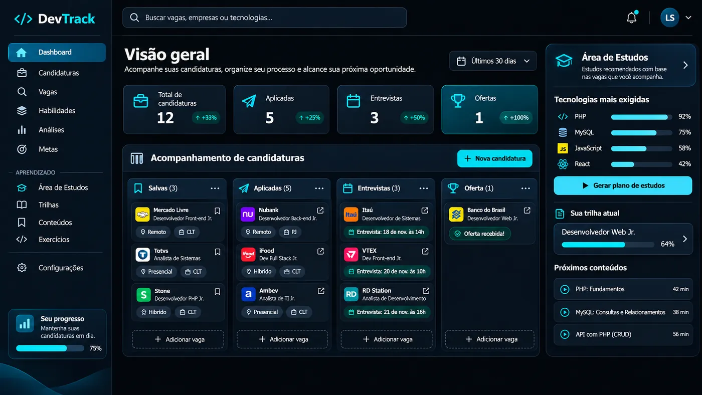

# DevTrack

**Organize your applications. Track your progress. Grow your tech career.**

**Current version:** `v0.3.1-alpha` · **Status:** In active development · **Next milestone:** Job application CRUD (`v0.4.0-alpha`)

DevTrack is a web application for students and early-career developers to manage job applications, follow recruitment stages, and eventually identify what to study based on the technologies requested in saved opportunities.

> **Project status:** The landing page, user registration and login, protected dashboard, logout, and profile avatar upload are functional in local development. Application cards, metrics, Kanban columns, and the study panel **still display sample data**. Job application persistence and personalized learning recommendations are not implemented yet.

## The problem

Keeping track of internships and junior developer positions across multiple job boards can be difficult. Meanwhile, understanding which skills to prioritize requires comparing job requirements manually.

DevTrack aims to bring **application tracking** and **career-oriented learning** into one organized experience.

## Interface preview



*The preview uses demonstration data. It is not a screenshot of real application statistics.*

The interface supports dark and light themes, remembers the selected theme in the browser, and uses responsive layouts with subtle glassmorphism effects.

## Features and current status

| Feature | Status |
| --- | --- |
| Public landing page with product overview | Implemented |
| Responsive navigation and dark/light themes | Implemented |
| Registration with server-side validation | Implemented |
| Login and logout using PHP sessions | Implemented |
| Password hashing and prepared PDO statements | Implemented |
| CSRF protection for authentication actions | Implemented |
| Protected dashboard routes | Implemented |
| Profile dropdown with avatar and sign-out option | Implemented |
| Profile photo upload (JPG, PNG or WebP, up to 2 MB) | Implemented |
| Dashboard metrics and Kanban cards | Demo data only |
| Study area and learning paths | Demo UI only |
| Create, edit, delete and filter job applications | Planned — `v0.4.0-alpha` |
| Real dashboard metrics and application status updates | Planned — `v0.5.0-beta` |
| Skill-gap analysis and study recommendations | Planned — `v1.1` |

**Security note:** Authentication is working locally, but this alpha build is **not production-hardened**. Public deployment with real users requires further security review, automated testing, HTTPS and protection against login abuse.

## Tech stack

| Layer | Technologies |
| --- | --- |
| Front-end | HTML5, CSS3, vanilla JavaScript |
| Back-end | PHP (without Laravel) |
| Database | MySQL |
| Data access | PDO and prepared statements |
| Architecture | Simplified MVC |
| Local environment | Laragon (Apache, PHP, MySQL) |
| Version control | Git and GitHub |

## Project structure

```text
devtrack/
├── app/
│   ├── config/
│   ├── controllers/
│   ├── helpers/
│   ├── middleware/
│   └── models/
├── database/
│   ├── schema.sql
│   ├── auth-users.sql
│   └── add-avatar-path.sql
├── docs/
│   ├── README.md
│   ├── escopo.md
│   ├── requisitos-funcionais.md
│   ├── requisitos-nao-funcionais.md
│   ├── regras-de-negocio.md
│   ├── modelo-de-dados.md
│   ├── landing-page.md
│   ├── autenticacao.md
│   └── perfil.md
├── public/
│   ├── assets/
│   │   ├── css/
│   │   ├── js/
│   │   └── img/
│   ├── uploads/avatars/
│   └── index.php
├── views/
│   ├── auth/
│   ├── dashboard/
│   ├── jobs/
│   ├── landing/
│   ├── layouts/
│   └── shared/
├── .gitignore
├── CHANGELOG.md
└── README.md
```

*Simplified view of the project. Some files may differ depending on the local installation.*

## Run locally

**Requirements:** Laragon (or a compatible Apache/PHP/MySQL environment), PHP with PDO MySQL enabled, MySQL, and Git.

1. Clone the repository into Laragon's `www` directory:

   ```powershell
   cd C:\laragon\www
   git clone https://github.com/luizsendret0/devtrack.git
   ```

2. Start **Apache** and **MySQL** in Laragon.
3. Create the `devtrack` database and import the SQL schema matching your installed version. The `users` table must include a unique `email`, and the profile feature requires the `avatar_path` column. Use the provided SQL scripts only when the corresponding table/column does not already exist.
4. Configure `app/config/database.php` with your local database credentials. **Never commit real passwords or secrets.**
5. Configure `devtrack.test` so its document root points to `C:\laragon\www\devtrack\public`.
6. Open `http://devtrack.test/` in your browser.

| URL | Purpose |
| --- | --- |
| `/` | Public landing page |
| `/?page=register` | Create an account |
| `/?page=login` | Sign in |
| `/?page=dashboard` | Protected dashboard (requires login) |

The avatar is changed from the profile menu in the dashboard. Images are stored under `public/uploads/avatars/` and their paths are associated with the user in MySQL. These URLs are publicly accessible, so do not upload private images.

## Roadmap

| Version | Milestone | Status |
| --- | --- | --- |
| `v0.1.0` | Project setup and folder structure | Completed |
| `v0.2.0-alpha` | Dashboard prototype, themes and glassmorphism | Completed |
| `v0.2.1-alpha` | Public landing page | Completed |
| `v0.3.0-alpha` | Registration, login, sessions and access control | Completed locally |
| **`v0.3.1-alpha`** | **Profile dropdown, photo upload and UI fixes** | **Current** |
| `v0.4.0-alpha` | Job application CRUD with ownership checks | Next |
| `v0.5.0-beta` | Database-driven dashboard, filters and Kanban | Planned |
| `v0.6.0-beta` | Automated tests, accessibility and stabilization | Planned |
| `v1.0.0` | Public-ready application-tracking MVP | Goal |
| `v1.1` | Technology analysis and recommended learning paths | Future |

*Milestone names are internal planning labels; they do not imply that GitHub tags or releases have been published.*

## Documentation

Technical documentation is available in [`docs/README.md`](./docs/README.md), including scope, functional/non-functional requirements, business rules, data model, [authentication](./docs/autenticacao.md), and [profile management](./docs/perfil.md).

## Next milestone

**v0.4.0-alpha — Job application management.** Replace demonstration application cards with records stored in MySQL. Users will be able to create, list, edit and delete **their own** job applications, with authorization checks on every operation.

## Author

**Luiz Felipe Sendreto**  
Systems Development student  
[GitHub](https://github.com/luizsendret0)

---

*Independent portfolio and learning project under active development.*
