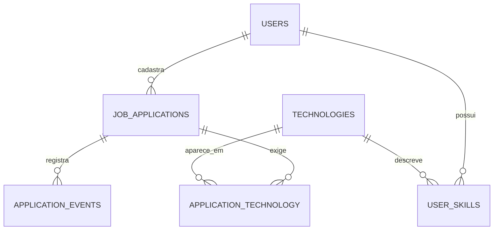

# Modelo de dados planejado — DevTrack

Este documento representa o **modelo-alvo**. Não assume que todas as tabelas já foram criadas no MySQL.

## MVP

### `users`

- `id` — chave primária.
- `name` — nome, obrigatório.
- `email` — e-mail único, obrigatório.
- `password` — hash da senha, obrigatório.
- `created_at` — data/hora de criação.

### `job_applications`

- `id` — chave primária.
- `user_id` — chave estrangeira de `users.id`, obrigatório.
- `company_name` — nome da empresa, obrigatório.
- `job_title` — nome do cargo, obrigatório.
- `job_url` — endereço da vaga, opcional.
- `status` — status conforme RN-04, obrigatório, padrão `salva`.
- `work_model` — remoto, híbrido, presencial; opcional.
- `employment_type` — estágio, CLT, PJ etc.; opcional.
- `salary` — remuneração informada, opcional e não negativa.
- `applied_at` — data em que a candidatura foi enviada, opcional conforme RN-07.
- `notes` — observações, opcionais.
- `created_at` e `updated_at` — timestamps.

**Relação:** `users` 1:N `job_applications`.

**Importante:** o `schema.sql` inicial pode conter menos campos. Atualize-o quando implementar novas funcionalidades; não altere dados de usuários sem estratégia de migração/backups.

## V1.1

### `technologies`

- `id`, `name` (único), `category`.

### `application_technology`

- `job_application_id` (FK), `technology_id` (FK).
- Chave composta para impedir duplicidade.
- Relação N:N entre vagas e tecnologias.

### `user_skills`

- `id`, `user_id` (FK), `technology_id` (FK), `proficiency`.
- Restrição única em `(user_id, technology_id)`.

### `application_events`

- `id`, `job_application_id` (FK), `old_status`, `new_status`, `created_at`.

## Diagrama simplificado

## Consultas e proteção

- Filtrar por `user_id` em toda consulta de candidatura.
- Validar autorização também antes de `UPDATE` e `DELETE`.
- Criar índices em `job_applications.user_id` e colunas filtradas com frequência conforme o uso real.
